<ul style="list-style-type:none; padding-left: 0.5rem;">
  <li style="margin-bottom: 0.5rem;">👨‍💻 <strong>Senior Software Engineer</strong> at <a href="https://myswimpro.com" target="_blank">@MySwimPro</a></li>
  <li style="margin-bottom: 0.5rem;">📱 <strong>Mobile</strong> | ⌚ <strong>Wearable</strong> | ☁️ <strong>Cloud Applications</strong> 🤖<strong>AI agents</strong> </li>
  <li style="margin-bottom: 0.5rem;">🍏 <strong>Swift | Objective-C | C++ | Go</strong></li>
  <li style="margin-bottom: 0.5rem;">🕹️ Former <strong>Game Developer</strong> 🎮</li>
  <li style="margin-bottom: 0.5rem;">📊 Former <strong>Statistical Programmer & Analyst</li>
</ul>

My last year on GitHub, defragmented. <a href="https://github.com/maximbilan/defrag-contributions">Get yours</a>
